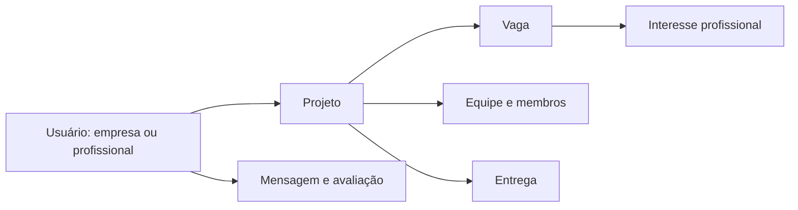

# TechCollab API — fundação do backend

**Estrutura inicial de uma plataforma de colaboração entre empresas e profissionais de tecnologia.**

Este repositório reúne o bootstrap Spring Boot, a configuração de infraestrutura e um modelo SQL para projetos, vagas, candidaturas e equipes. Ele representa a **fundação técnica e a modelagem do domínio**, não uma API funcional completa desses recursos.

## O que existe nesta versão

| Artefato | Estado |
| --- | --- |
| Aplicação Spring Boot | Classe de inicialização com cache habilitado. |
| Dependências | Web, JPA, MySQL, Flyway, HATEOAS, OpenAPI, cache e ModelMapper. |
| Modelo relacional | Script SQL na raiz com tabelas e relacionamentos do domínio. |
| Migração no classpath | Arquivo inicial com comentários, ainda sem criação das tabelas. |
| Endpoints de negócio | Controllers e serviços ainda não estão presentes nesta revisão. |

## Modelo proposto



[`V1__Create_Tables.sql`](V1__Create_Tables.sql) descreve usuários com dados específicos de empresa e profissional, habilidades, projetos, vagas, interesses, equipes, mensagens, avaliações e entregas. São definições de banco, não comprovação de que os respectivos fluxos HTTP estejam implementados.

## Stack

**Java 17, Spring Boot 3.3.1, Maven, MySQL, Spring Data JPA, Flyway, Spring HATEOAS, Springdoc OpenAPI 2.5.0 e ModelMapper 3.1.0.** As versões estão em [`pom.xml`](pom.xml).

## Preparar o ambiente

```bash
git clone https://github.com/dlr-1337/techcollab-api.git
cd techcollab-api
```

Use JDK 17, Maven e um MySQL de desenvolvimento. Crie um banco vazio para o estudo:

```sql
CREATE DATABASE IF NOT EXISTS techcollab_db;
```

Configure `SPRING_DATASOURCE_URL`, `SPRING_DATASOURCE_USERNAME` e `SPRING_DATASOURCE_PASSWORD` no ambiente privado da aplicação. A referência JDBC está em [`application.properties`](src/main/resources/application.properties).

O arquivo de propriedades contém um comentário na mesma linha de `spring.jpa.open-in-view`. Para evitar que esse texto seja interpretado como parte do booleano, configure `SPRING_JPA_OPEN_IN_VIEW=false` no ambiente ou coloque o comentário em uma linha própria na sua cópia local.

```bash
mvn spring-boot:run
```

A porta configurada é **8080**, com Swagger em `/swagger-ui.html` e OpenAPI em `/v3/api-docs`. Nesta base, a interface de documentação não oferece os endpoints de negócio que ainda precisam ser desenvolvidos.

## Atenção às migrações

O SQL completo está na **raiz**; a migração em [`src/main/resources/db/migration`](src/main/resources/db/migration/) contém apenas comentários. Portanto, iniciar a aplicação não aplica automaticamente o modelo completo da raiz.

Ao evoluir o projeto, transforme o modelo revisado em migrações efetivas, respeitando o histórico já aplicado ao banco escolhido. Não trate o nome `V1` da cópia da raiz como prova de que ela já tenha sido executada.

## Navegação pelo código

- [`ApiApplication.java`](src/main/java/br/com/techcollab/api/ApiApplication.java): inicialização da aplicação.
- [`application.properties`](src/main/resources/application.properties): conexão, JPA, Flyway e OpenAPI.
- [`V1__Create_Tables.sql`](V1__Create_Tables.sql): modelagem do domínio.

Para verificar o build disponível, execute `mvn package`. O próximo passo de implementação é conectar a modelagem a entidades, repositórios, serviços, controllers e testes de contrato, sem apresentar essa evolução planejada como recurso já entregue.
